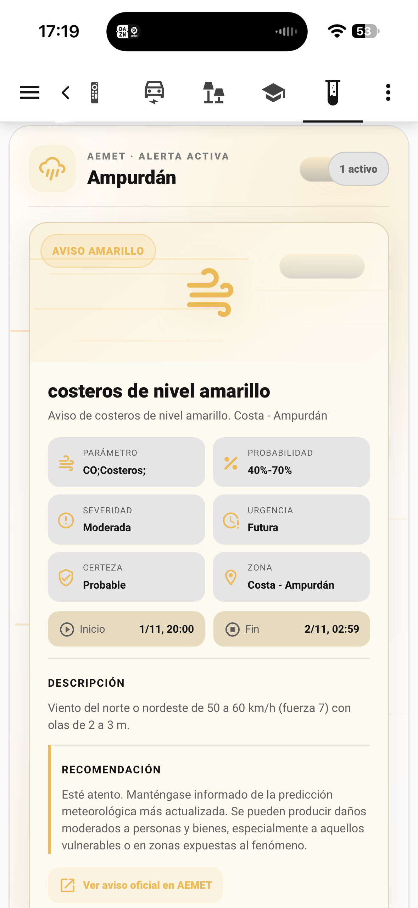
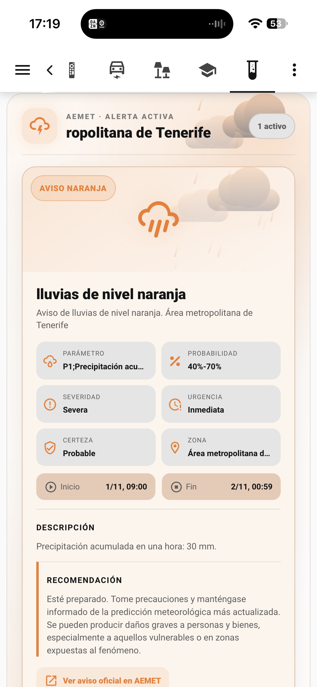

<div align="center">

# 🌦️ AEMET Alertas Card

**Tarjeta Lovelace para visualizar los avisos meteorológicos de AEMET en Home Assistant.**

[](https://github.com/jacumal/aemet-alertas-card/actions/workflows/hacs.yaml)
[](https://github.com/jacumal/aemet-alertas-card/releases)
[](LICENSE)
[](https://www.home-assistant.io/)

</div>

---

## ✨ ¿Qué es?

**AEMET Alertas Card** es una tarjeta personalizada de Lovelace diseñada para trabajar con la integración [AEMET Alertas](https://github.com/jacumal/aemet-alertas).

Permite presentar los avisos meteorológicos activos de una zona de Home Assistant de una forma clara, visual y adaptada al **espacio real disponible de la tarjeta**, desde móvil hasta dashboards de escritorio y pantallas grandes.

## 📸 Vista previa

Ejemplos reales de la tarjeta mostrando diferentes niveles y tipos de avisos meteorológicos:

<table>
<tr>
<td align="center" width="50%">

<br><sub>🟠 Aviso naranja · Área metropolitana de Tenerife</sub>
</td>
<td align="center" width="50%">

<br><sub>🟡 Aviso amarillo · Costa - Ampurdán</sub>
</td>
</tr>
</table>

> **Importante:** este proyecto es independiente y **no está afiliado, patrocinado, respaldado ni mantenido por AEMET**.

## 🎨 Características

- 🟡🟠🔴 **Colores dinámicos** según el nivel del aviso.
- 📋 **Modo compacto** para el dashboard principal.
- 🔎 **Modo detallado** con toda la información relevante del aviso.
- 🔄 **Modo automático**: detallado cuando existen avisos y compacto cuando no los hay.
- 🌧️ Soporte para **múltiples avisos activos**.
- 📱 **Responsive por ancho real de tarjeta**, no por tamaño de pantalla.
- 🖥️ Aprovecha mejor el espacio en tablets, escritorio y dashboards panorámicos.
- 🧱 Compatible con el sistema moderno `getGridOptions()` de Home Assistant Sections.
- ↔️ El usuario puede **redimensionar la tarjeta** desde el editor de Home Assistant.
- 🌙 Compatible con los temas claro y oscuro de Home Assistant.
- 🧩 Sin dependencias externas ni Browser Mod.
- 🧭 Enlace directo al aviso publicado por AEMET cuando está disponible.
- 🧱 Selector de tarjeta de Home Assistant mediante `window.customCards`.

---

## 🚀 Instalación con HACS

La tarjeta está preparada como repositorio **Dashboard / Plugin** de HACS.

### Repositorio personalizado

Mientras el repositorio no forme parte del catálogo predeterminado de HACS:

1. Abre **HACS**.
2. Entra en **Dashboard**.
3. Abre el menú **⋮ → Repositorios personalizados**.
4. Añade:

   `https://github.com/jacumal/aemet-alertas-card`

5. Selecciona la categoría **Dashboard**.
6. Instala **AEMET Alertas Card**.
7. Reinicia o recarga los recursos del frontend si Home Assistant lo solicita.

HACS utiliza `aemet-alertas-card-responsive.js` como punto de entrada oficial. Este recurso importa la tarjeta estable y añade el sistema de layout responsive por ancho real y el soporte de tamaño para Sections.

---

## 🧩 Requisitos

Necesitas:

- Home Assistant.
- HACS.
- La integración **[AEMET Alertas](https://github.com/jacumal/aemet-alertas)** instalada y configurada.

La tarjeta no obtiene datos directamente de AEMET: utiliza los atributos de la entidad proporcionada por la integración.

---

## ⚙️ Configuración

### Modo compacto

Ideal para la pantalla principal del dashboard:

```yaml
type: custom:aemet-alertas-card
entity: sensor.alertas_amarillas_litoral_norte_de_valencia
mode: compact
```

Muestra el nivel, la zona, el número de avisos y un resumen de los fenómenos activos.

### Modo detallado

Para una vista meteorológica específica:

```yaml
type: custom:aemet-alertas-card
entity: sensor.alertas_amarillas_litoral_norte_de_valencia
mode: detailed
```

Incluye, cuando están disponibles:

- Fenómeno.
- Zona.
- Parámetro.
- Probabilidad.
- Severidad.
- Urgencia.
- Certeza.
- Inicio y finalización.
- Descripción.
- Recomendaciones.
- Enlace al aviso de AEMET.

### Modo automático

```yaml
type: custom:aemet-alertas-card
entity: sensor.alertas_amarillas_litoral_norte_de_valencia
mode: auto
```

Con `auto`, la tarjeta utiliza el modo detallado cuando existen avisos activos y muestra un estado limpio cuando no hay avisos.

### Mostrar el estado sin avisos

Por defecto, la tarjeta se muestra aunque no existan avisos. Puedes ocultarla completamente con:

```yaml
type: custom:aemet-alertas-card
entity: sensor.alertas_amarillas_litoral_norte_de_valencia
mode: compact
show_when_clear: false
```

### Limitar el número de avisos

```yaml
type: custom:aemet-alertas-card
entity: sensor.alertas_amarillas_litoral_norte_de_valencia
mode: detailed
max_alerts: 3
```

El valor predeterminado es `5`.

---

## 📐 Ancho y layout responsive

La versión oficial utiliza el **ancho real que Home Assistant asigna a la tarjeta**. Esto evita un problema habitual en dashboards: una pantalla de escritorio puede ser enorme, pero una tarjeta concreta puede ocupar solo media sección.

El diseño cambia automáticamente según el ancho de la propia tarjeta:

| Ancho aproximado de la tarjeta | Layout |
|---|---|
| `< 560 px` | 📱 Vertical, optimizado para móvil |
| `560–759 px` | 📲 Horizontal compacto, pensado para tablet |
| `760–1099 px` | 🖥️ Horizontal amplio, con métricas en 3 columnas |
| `1100–1399 px` | 🖥️✨ Escritorio ancho |
| `≥ 1400 px` | 🖥️✨ Pantallas grandes / wall dashboards |

Esto significa que **no importa si el dispositivo es un móvil, iPad, portátil o PC**: la tarjeta responde al espacio que realmente tiene.

### Redimensionar la tarjeta en Home Assistant

En los dashboards modernos de tipo **Sections**, Home Assistant utiliza una cuadrícula de 12 columnas. La tarjeta declara un tamaño inicial de ancho completo y permite reducirla hasta 6 columnas.

Puedes modificar el ancho desde el editor visual de Home Assistant o mediante `grid_options`:

```yaml
type: custom:aemet-alertas-card
entity: sensor.alertas_amarillas_litoral_norte_de_valencia
mode: detailed
grid_options:
  columns: 12
  rows: 8
```

Para una tarjeta a media anchura:

```yaml
grid_options:
  columns: 6
  rows: 8
```

El objetivo es que cada usuario pueda decidir cuánto espacio quiere dedicar a AEMET sin que la tarjeta tenga que conocer el tamaño de su monitor.

> 💡 **Recomendación:** en escritorio y wall dashboards, utiliza una tarjeta de `9` o `12` columnas para aprovechar el layout horizontal. En móvil normalmente Home Assistant la mostrará a ancho completo automáticamente.

---

## 🟢🟡🟠🔴 Niveles de aviso

La tarjeta interpreta los niveles proporcionados por AEMET Alertas:

| Nivel | Presentación |
|---|---|
| 🟢 Verde | Sin riesgo meteorológico relevante |
| 🟡 Amarillo | Aviso amarillo |
| 🟠 Naranja | Aviso naranja |
| 🔴 Rojo | Aviso rojo |

El nivel se obtiene de los datos del aviso y se utiliza para adaptar automáticamente la interfaz.

---

## 🧱 Estructura del repositorio

```text
.
├── .github/
│   └── workflows/
│       └── hacs.yaml
├── aemet-alertas-card.js
├── aemet-alertas-card-responsive.js
├── aemet-alertas-card-core.js
├── hacs.json
├── README.md
├── screenshots/
│   ├── aemet-alerta-naranja-tenerife.PNG
│   └── aemet-alerta-amarillo-ampurdan.PNG
└── LICENSE
```

El punto de entrada de HACS es `aemet-alertas-card-responsive.js`. Este módulo importa la implementación estable de `aemet-alertas-card.js`, mientras que `aemet-alertas-card-core.js` contiene la lógica principal de la tarjeta.

Las variantes experimentales y prototipos responsive se han eliminado del repositorio público para mantener una estructura limpia y evitar que los usuarios carguen archivos obsoletos por error.

---

## 🛠️ Desarrollo

El punto de entrada oficial es:

```text
aemet-alertas-card-responsive.js
```

Este módulo importa la tarjeta estable `aemet-alertas-card.js` y aplica:

- Layout responsive mediante **CSS Container Queries**.
- Adaptación al ancho real de la tarjeta.
- Distribución horizontal progresiva en tarjetas anchas.
- Soporte `getGridOptions()` para Home Assistant Sections.
- Conservación del comportamiento estable del marquee y del renderizado actual.

La tarjeta utiliza APIs estándar del frontend de Home Assistant y Web Components nativos.

Para probar cambios localmente, carga el recurso JavaScript desde tu instancia de Home Assistant y actualiza el navegador después de modificarlo.

---

## ☕️ Apoya el proyecto

Si **AEMET Alertas Card** te resulta útil, puedes apoyar su desarrollo con un café:

<p align="center">
  <a href="https://www.buymeacoffee.com/jacumal">
    
  </a>
</p>

El apoyo es totalmente opcional y ayuda a mantener y mejorar el proyecto.

---

## ⚖️ Aviso legal

AEMET Alertas Card utiliza información proporcionada por la integración AEMET Alertas, cuyos datos proceden de los canales oficiales de AEMET.
